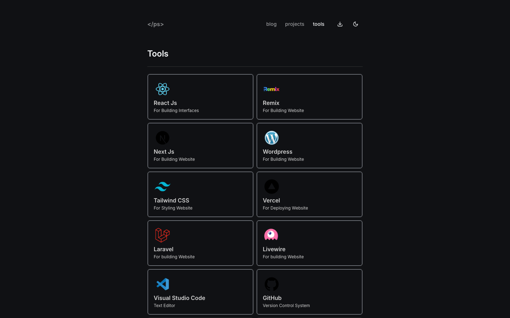

<h1 align="center">petershaan.net, version 2</h1>

<p align="center">
  Personal portfolio and blog of <a href="https://github.com/petershaan12">Peter Shaan</a>, rebuilt with <a href="https://remix.run">Remix</a>.<br />
  This is an archived version. The live site is <a href="https://petershaan.net">petershaan.net</a>, and all versions are listed in the <a href="https://github.com/petershaan12/petershaan.net/tree/version-3"><code>version-3</code></a> branch.
</p>

## Screenshots

| Home | Blog |
| --- | --- |
|  |  |
| **Blog post** | **Projects** |
|  |  |
| **Tools** | |
|  | |

## Features

- Remix (Vite) and TypeScript
- Tailwind CSS and shadcn/ui components
- Blog written in MDX with tags, syntax highlighting (Shiki) and linked headings
- View counter stored in MongoDB
- Dynamic OG images with `@vercel/og`
- Light and dark theme (`remix-themes`)
- Google Analytics

The design is inspired by [luma.com](https://luma.com) and [leerob.io](https://leerob.io), but the code is written from scratch.

## Run it locally

Requirements: Node.js 20+ and a MongoDB database (a free [MongoDB Atlas](https://www.mongodb.com/atlas) cluster works).

```bash
git clone -b version-2-remix https://github.com/petershaan12/petershaan.net.git
cd petershaan.net
npm install
cp .env.example .env
npm run dev
```

Open the URL printed in the terminal (usually [http://localhost:5173](http://localhost:5173)).

Environment variables (`.env`):

| Variable | Required | What it is for |
| --- | --- | --- |
| `MONGODB_URI` | yes | MongoDB connection string for the view counter |
| `REMIX_PUBLIC_APP_URL` | yes | Site URL, e.g. `http://localhost:5173` |
| `GA_TRACKING_ID` | no | Google Analytics ID |

Blog posts are MDX files in `content/blog`.

Production build (`remix-serve` does not read `.env`, so export the variables first):

```bash
npm run build
set -a && . ./.env && set +a
npm start
```

## License

Feel free to use this code for your own website, but please credit me and do not copy my personal content (text, photos, posts).
