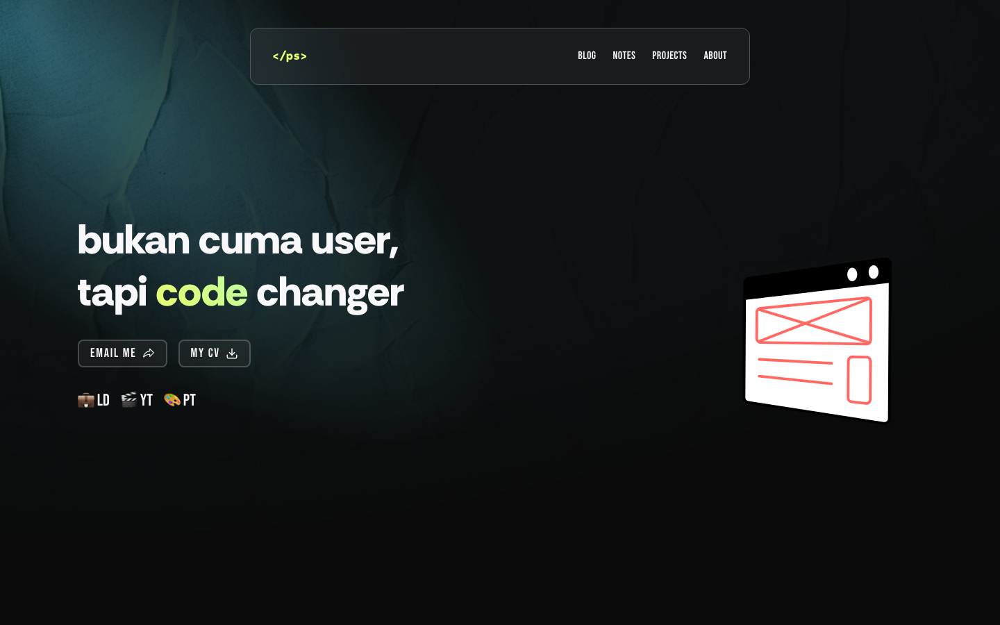

<div align="center">
  
</div>
<h1 align="center">
  petershaan.com
</h1>
<p align="center">
  <a href="https://github.com/petershaan12" alt="author">
        </a> </br>
  Publish on <a href="https://petershaan.com" target="_blank">petershaan.com</a> built with <a href="https://nextjs.org/" target="_blank">Nextjs</a> and hosted with <a href="https://vercel.com/" target="_blank">Vercel</a>
</p>


## 🗂 Semua Versi (All Versions)

| Versi | Branch | Preview |
| --- | --- | --- |
| 1 | [`version-1`](https://github.com/petershaan12/petershaan.net/tree/version-1) |  |
| 2 | [`version-2-remix`](https://github.com/petershaan12/petershaan.net/tree/version-2-remix) |  |
| 3 | [`version-3`](https://github.com/petershaan12/petershaan.net/tree/version-3) |  |
| 4 (live) | [petershaan.net](https://petershaan.net) |  |

## 🚨 Tentang Repo ini (About This Repo)

Haii 👋 you can use this code for your own website, but please dont forget me for copyright 😊.

Please note that the design of the website is inspired from "https://luma.com/" and "https://leerob.io/", but didn't copied all the code, However, i built the portfolio from scratch with `Next JS`, `Tailwind CSS`, `ShadCdn`,  `Velite`, `Upstash`  and i added some other functionalities to it, so it might seems the same, but believe me i did a lot of work the code, website and how it works is entirely different!!!!. If you have questions about implementation, please refer to the [Next.js DOCS](https://nextjs.org/docs) 

### 🛠 Fitur Website 2.0

1. Typescript
2. fitur MDX
3. Shadcdn
4. Velite
5. OG Image
6. Ada Fitur Watchernya dong pake upstash

### 🛠 Cara Menggunakan (How to Use)

1. Clone the repo CLI

   ```sh
   git clone -b version-2-remix https://github.com/petershaan12/petershaan.net.git
   ```

2. Install use NPM 

   ```sh
   npm i
   ```

3. Run The App

   ```sh
   npm run dev / yarn dev
   ```
