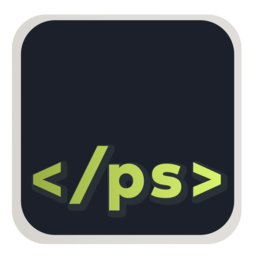
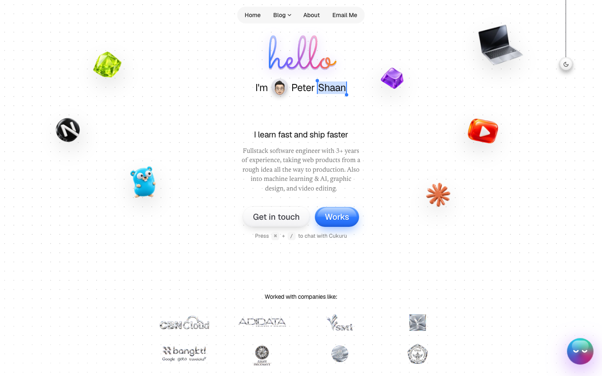
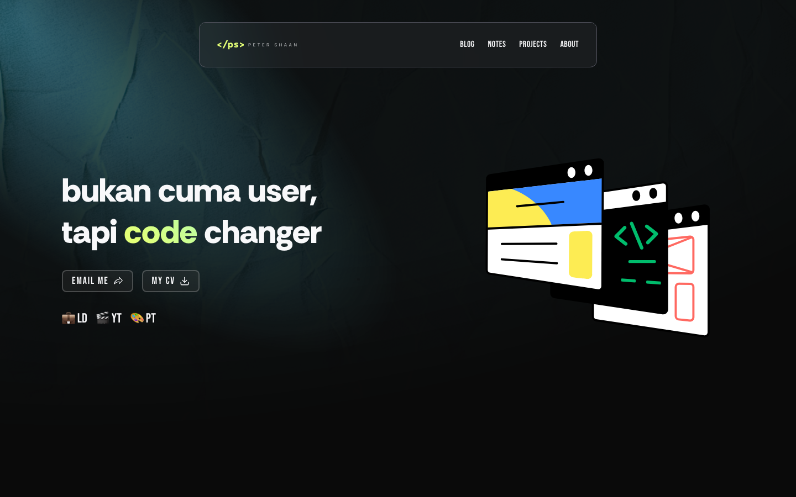
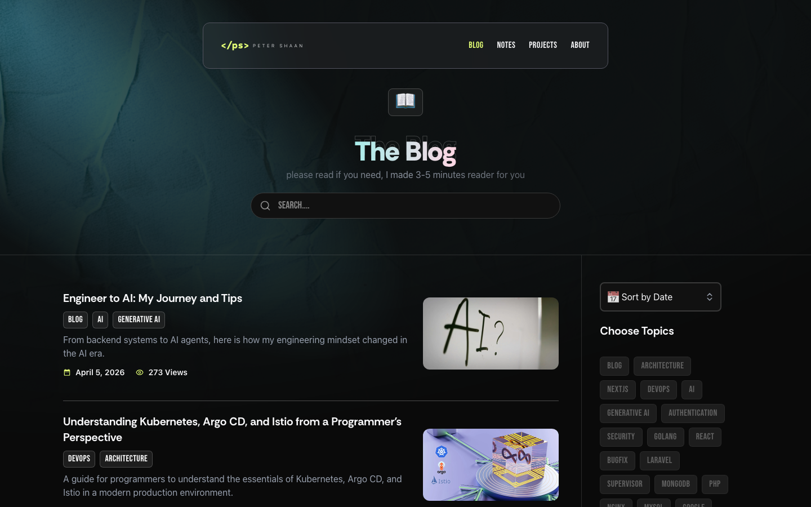
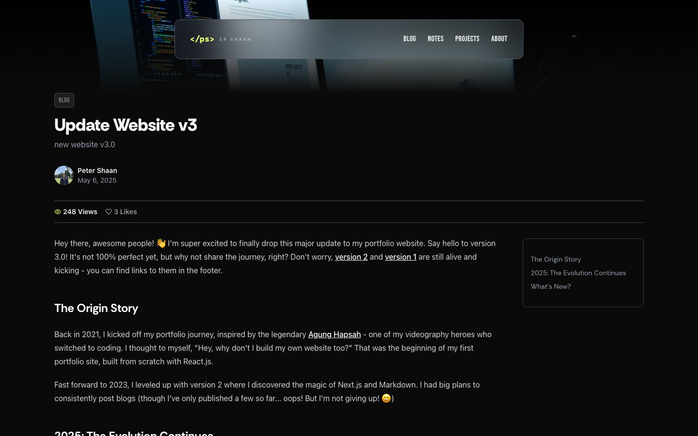
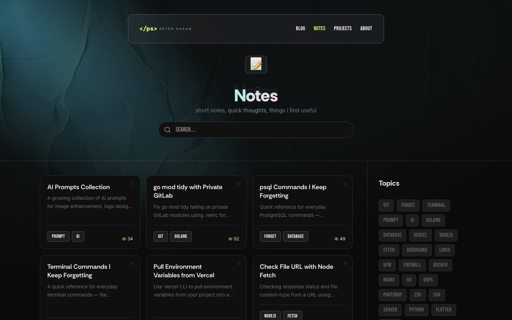
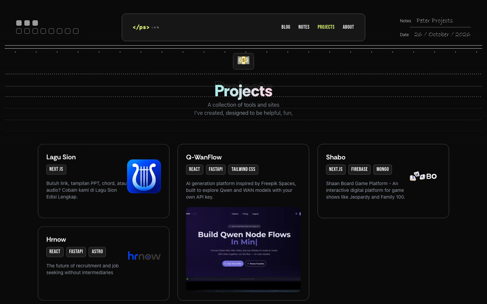
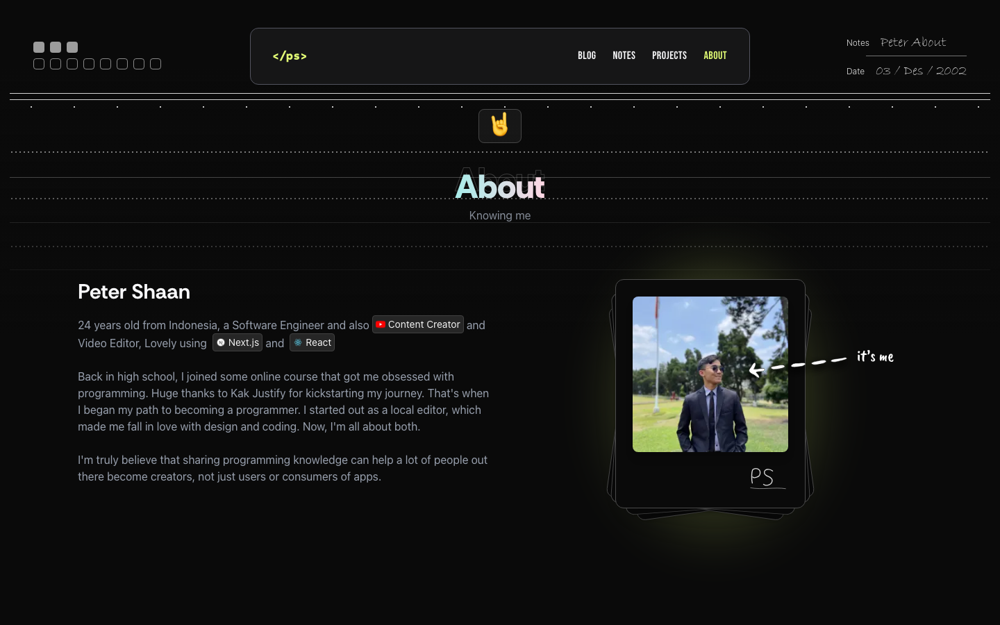
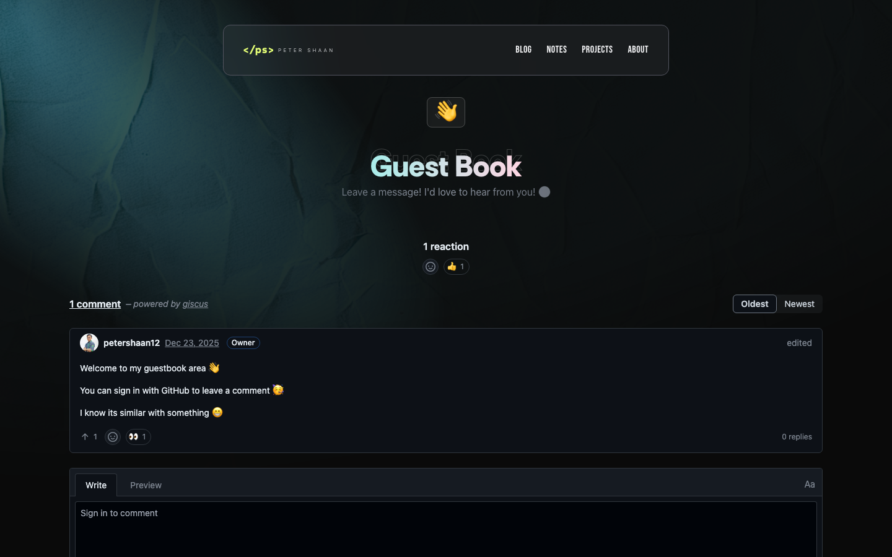

<p align="center">
  
</p>

<h1 align="center">petershaan.net</h1>

<p align="center">
  Personal portfolio and blog of <a href="https://github.com/petershaan12">Peter Shaan</a>.<br />
  Live at <a href="https://petershaan.net">petershaan.net</a>
</p>

This repo is the public archive of every version of my website. Each version lives in its own branch. You are on **version 3**.

## All versions

| Version | Branch | Stack | Preview |
| --- | --- | --- | --- |
| 4 (live) | closed source | Next.js 16, React 19, Tailwind v4, MongoDB |  |
| 3 | [`version-3`](https://github.com/petershaan12/petershaan.net/tree/version-3) (this branch) | Next.js 16, React 19, Tailwind v4, MongoDB |  |
| 2 | [`version-2-remix`](https://github.com/petershaan12/petershaan.net/tree/version-2-remix) | Remix, Vite, Tailwind, MDX, MongoDB |  |
| 1 | [`version-1`](https://github.com/petershaan12/petershaan.net/tree/version-1) | Next.js 14, JavaScript, Tailwind |  |

## Version 3

### Screenshots

| Home | Blog |
| --- | --- |
|  |  |
| **Blog post** | **Notes** |
|  |  |
| **Projects** | **About** |
|  |  |
| **Guestbook** | |
|  | |

### Features

- Next.js 16 App Router, React 19, TypeScript
- Tailwind CSS v4 and shadcn/ui (Radix)
- Blog, notes and projects stored in MongoDB and edited through a private CMS
- MDX compiled on save (Shiki, rehype-slug, autolinked headings)
- Like and view counters, guestbook, newsletter subscribe and email notifications (Nodemailer)
- Dynamic OG images, RSS feed, sitemap and JSON-LD
- Image uploads to Vercel Blob
- Animations with Framer Motion and Lottie

### Run it locally

Requirements: Node.js 20+ and a MongoDB database (a free [MongoDB Atlas](https://www.mongodb.com/atlas) cluster works).

```bash
git clone -b version-3 https://github.com/petershaan12/petershaan.net.git
cd petershaan.net
npm install
cp .example.env .env.local
npm run dev
```

Open [http://localhost:3000](http://localhost:3000).

Environment variables (`.env.local`):

| Variable | Required | What it is for |
| --- | --- | --- |
| `MONGODB_URI` | yes | MongoDB connection string. Content is read from the `peterhiku12` database. |
| `NEXT_PUBLIC_APP_URL` | yes | Site URL, e.g. `http://localhost:3000` |
| `EMAIL_USER`, `EMAIL_PASS` | for email | Gmail address and app password for subscribe and notify emails |
| `PETER_ADMIN` | for CMS | Secret path where the CMS is served |
| `PETER_KEY` | for CMS | CMS password, also the `x-api-key` for `/api/notify` |
| `PETER_READ_WRITE_TOKEN` | for uploads | Vercel Blob read/write token |

Production build:

```bash
npm run build
npm start
```

A `Dockerfile` is included as well.

## License

Feel free to use this code for your own website, but please credit me and do not copy my personal content (text, photos, posts).
